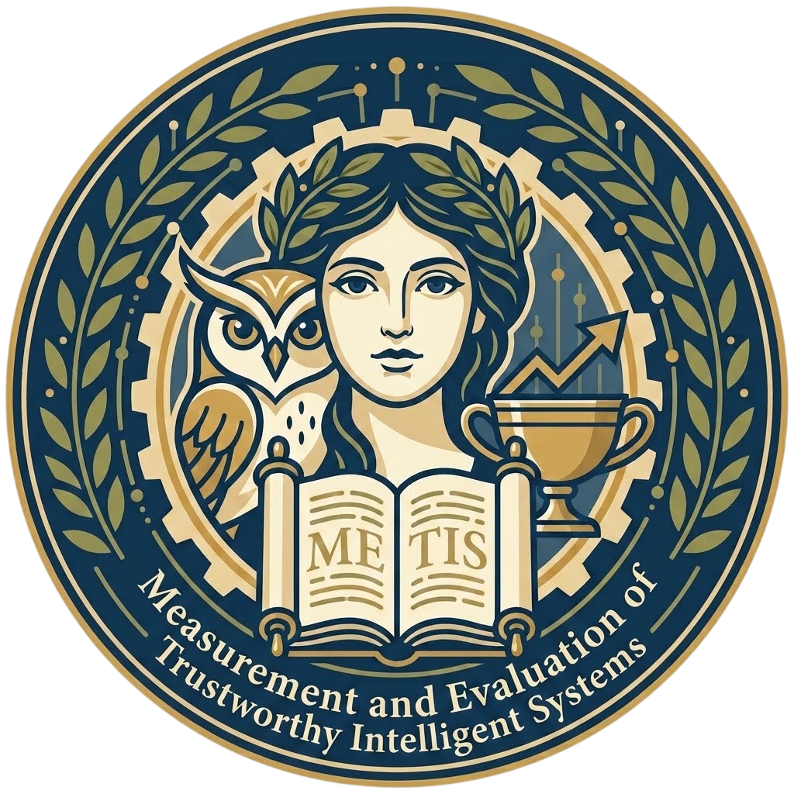

<p align="center">
  
</p>

# METIS

**Measurement and Evaluation of Trustworthy Intelligent Systems**

METIS is an extensible agentic evaluation suite for assessing AI safety, alignment, and operational reliability. It ingests agent execution traces (from platforms like Langfuse and OpenTelemetry), runs configurable evaluation metrics against them, and produces diagnostics and compliance analytics.

## Architecture

```
                        ┌─────────────┐
                        │  METIS-web  │  (Web frontend — Stage 3)
                        └──────┬──────┘
                               │ HTTP
                        ┌──────▼──────┐
                        │  METIS-api  │  (REST service — Stage 3)
                        └──────┬──────┘
                               │
       ┌───────────────────────┼───────────────────────┐
       │                       │                       │
┌──────▼──────┐   ┌───────────▼───────────┐   ┌──────▼──────┐
│ METIS-wizard│   │     METIS-engine      │   │METIS-insights│
│  Config Gen │   │  Evaluation Runtime   │   │  Analytics   │
└──────┬──────┘   └───────────┬───────────┘   └──────┬──────┘
       │                      │                       │
       │              ┌───────▼───────┐               │
       └─────────────►│ METIS-metrics │◄──────────────┘
                      │   Catalog     │
                      └───────┬───────┘
                              │
                      ┌───────▼───────┐
                      │  METIS-core   │
                      │Domain Schemas │
                      └───────────────┘
```

| Package | Description |
|---------|-------------|
| **metis-core** | Domain schemas (Trace, Span, Score, AssertionResult) and standard interfaces |
| **metis-metrics** | Shared metric catalog — built-in evaluators and authoring utilities |
| **metis-engine** | Dynamic multi-agent evaluation runtime; ingests traces and executes metrics |
| **metis-wizard** | Automated spec and evaluation config generator (interactive CLI) |
| **metis-insights** | Trajectory diagnostics and compliance analytics (Stage 2) |

## Quickstart

### Prerequisites

- Python >= 3.11
- [uv](https://docs.astral.sh/uv/) (workspace and package manager)

### Install

```bash
make install
```

This runs `uv sync --group dev`, installing all workspace packages and development tools into a single virtualenv.

### Usage

```bash
# Generate an evaluation config interactively
metis wizard init

# Run evaluations against a trace file
metis engine run --trace-file path/to/trace.json

# View results (Stage 2)
metis insights report --results-file path/to/results.json
```

Each sub-command is also available as a standalone CLI (`metis-engine`, `metis-wizard`, `metis-insights`).

## Development

```bash
make check          # lint + format-check + typecheck (non-mutating)
make fix            # auto-fix lint issues and format code
make ci             # full CI suite
make clean          # remove generated/cached files
```

| Target | Behavior |
|--------|----------|
| `install` | Install all workspace dependencies (including dev group) |
| `lint` | Run Ruff lint checks |
| `lint-fix` | Apply Ruff lint autofixes |
| `format` | Format all Python files with Ruff |
| `format-check` | Check formatting without modifying files |
| `fix` | Lint autofix + format |
| `typecheck` | Run Pyright type checking |
| `check` | `lint` + `format-check` + `typecheck` |
| `ci` | `check` + `test` |
| `clean` | Remove all generated/cached files |

## Project Layout

```
metis/
├── pyproject.toml          # Workspace root
├── metis_cli.py            # Unified CLI entry point
├── uv.lock                 # Single lockfile
├── packages/
│   ├── core/               # metis-core
│   ├── metrics/            # metis-metrics
│   ├── engine/             # metis-engine
│   └── wizard/             # metis-wizard
├── apps/
│   ├── api/                # REST backend (Stage 3)
│   └── web/                # React frontend (Stage 3)
├── tests/
│   ├── unit/
│   ├── integration/
│   └── fixtures/
└── docs/
```

## Versioning

All packages share a unified version derived from git tags via `hatch-vcs`. Untagged builds produce dev suffixes (e.g., `0.1.0.dev3+gabcdef`).

```bash
metis --version
```

## Roadmap

| Stage | Scope | Status |
|-------|-------|--------|
| 1 — MVP | `core`, `metrics`, `engine` (CLI evaluation of pre-recorded traces) | Active |
| 2 — Developer Experience | `wizard`, `insights` (config generation, reporting) | Planned |
| 3 — Web Platform | `apps/api`, `apps/web` (REST service + frontend) | Deferred |
| 4 — Generalized METIS | `testbed` (live sandbox, agent calibration) | Deferred |
